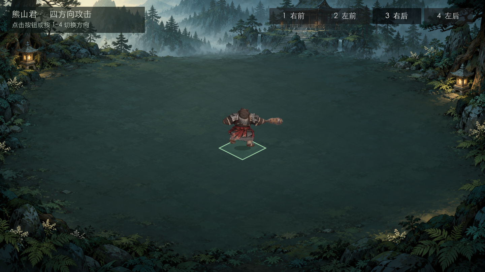
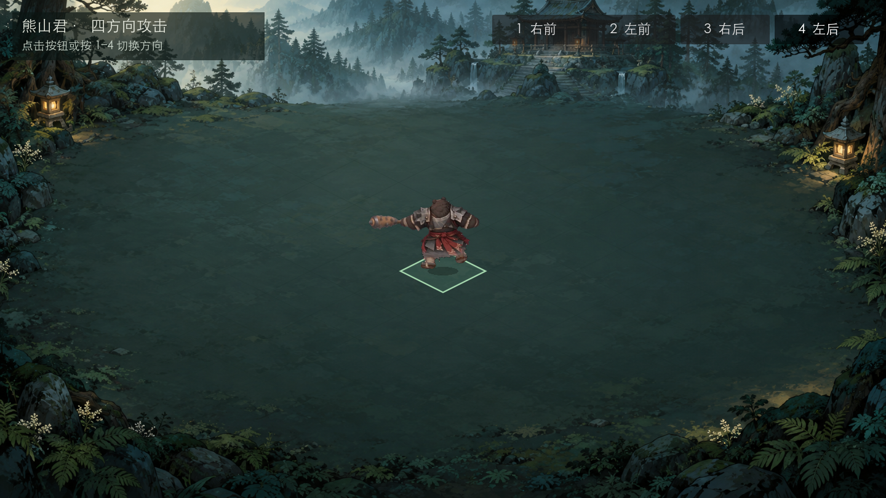

# 熊山君四方向攻击独立验收 · 2026-10-29

结论：**本轮限定技术通过，关键时刻图形抽检通过，没有新增必修问题。** 正面与背面各使用自己的原声和播放时刻，左右方向只做围绕脚锚的水平镜像。仍为独立单熊棋盘展示，不据此宣称正式游戏集成或完整视觉／设备听感验收通过。

## 对象和证据

- 基线 `9e6089a954cf8ac4eb5064035b94cc1a5f113518`；本轮05背面候选与06四方向运行文件冻结后独立检查。验收时未提交，最终374个运行文件散列见[结构化证据](QA_BEAR_FOUR_DIRECTIONS_20261029.json)，结束时全部仍与冻结副本相同。
- 认可背面源 SHA-256 `30ef7c2cf59580e9b257300cd884fda4fa10359490389f98553889cbe97c1682`，归档在 `godot-demo/art/candidates/bear_lord_back_attack_v1/source/bear-back-short-repaired-v1.mp4`。
- 独立脚本：[素材／复建](qa07-bear-four-directions-20261029.py)、[运行／输入](qa07-bear-four-directions-20261029.gd)、[关键时刻截图](qa07-bear-four-critical-capture-20261029.gd)。07没有修改生产代码或媒体转换参数。

## 实际通过的检查

| 范围 | 结果 |
| --- | --- |
| 素材及接入文件 | 最终2060项、0失败。源文件身份、340帧原始PTS／持续时间／顺序、全部PNG散列、384×320 RGBA、非空与四边透明均符合。运行340帧、manifest、WAV逐字节等于05候选。 |
| 完整隔离复建 | 从入库MP4和build.py在新临时目录重新解码、处理全部340帧。生成manifest完全相同，340张PNG和WAV全部字节相同；没有使用作者解码缓存。 |
| 原音 | 独立解码原AAC后，交付WAV的115968个双声道采样逐样本等于源开头，无换声、混音、倒放或起始偏移。32kHz／16-bit／3.624秒；仅末尾768采样编码尾垫被去除，尾垫幅度不超过1 LSB。 |
| 运行源码 | 07独立1539项、0失败，真实场景树鼠标事件点四按钮、1–4按键事件、选中态、无效／重复按键边界、快速切换、不同动作时长和音轨。 |
| 无缓存首启 | 07另复制374文件，排除`.godot`、`.import`和`.uid`；无需预导入即首次加载，再跑相同1539项、0失败。 |
| 播放完整性 | 每个源时刻、边界前一点、停留区间中点、末帧尾停、跨循环逐项验证。30／60／120FPS的两周期均按原时间选择画面；不把低显示帧率无法呈现每个96FPS源时刻误报为丢失资产。 |
| 镜像和落脚 | 本地脚锚(177,213)在四方向始终映射到棋盘(720,441)，倍率0.75。镜像对应点严格满足`x左=1440−x右`、y不变，复用原纹理与前进时间，原声不反转。实际绘制变换亦与该映射一致。 |
| 音频生命周期 | 一个播放器、复音数1；切方向先停旧声，画面归零且所选原音从0开始；大步长跨周期只播放最终周期相位，进入音轨结束后的间隔保持静音。front周期3.85秒、原声3.622313秒；back周期3.891667秒、原声3.624秒。 |
| 旧素材保持 | 正面20PNG、manifest、原音、棋盘共23文件与基线完全相同。本轮独立展示不引用旧游戏场景或战斗入口。 |

## 关键画面抽检

用独立干净副本和真实Godot 4.7.2 OpenGL Compatibility／Apple M1窗口，静音截取**1.625秒、背面源第157帧**的两个方向。按钮由真实场景树Control输入触发，没有直接改方向字段。

两图中棍头完整，角色比例与落脚点一致，镜像正确，未见白底矩形或新增出画。腿／下摆有可辨认的灰软带，属于05已记录的源灰挥击弧及有限去雾近似；不将它描述为无瑕疵。截图只证明该关键时刻，不能代替完整连续观感。

## 首轮诊断及范围调整

- 素材首轮2060项有效检查之外，夹具额外强求每张图所有`alpha=0`像素的RGB也必须严格为0，产生340条诊断。直通道RGBA不要求该条件，Pillow整数量化残留的RGB最大20且alpha仍0；改为记录指标。非空、画布四边透明及完整散列核验仍严格保留，没有放宽可见边界或改生产素材。
- 最初一次范围核验中`godot-demo`无差异；复跑期间出现大量旧资产／试玩代码迁移。根代理只读核实来自用户明确授权的“项目清理｜废弃内容与归档”并行会话。故最终核验限定本轮文件及正面23文件，不冒称整个共享仓库无差异，也没有覆盖、回退、测试或代提交另一批清理。
- 首次受限图形调用未进入画面；只终止本轮新建PID67380，经自动审批改用专用静音窗口，两张图保存后退出。源码headless运行曾有日志目录／系统证书环境告警；PNG原始文件加载的导出告警仍在，不影响本次源码运行，不据此宣布发行包可用。

## 保留限制与交接

- 正面仍为之前20张稀疏选帧；本轮没有补足正面动态。背面340解码时刻对应326张不同PNG，其中含原片重复姿势和编码差异，不等于340个独立动作姿势。
- 原第152–185附近灰软感、既有棍头修补、运动模糊与循环回首帧的源表现保留。05／根代理的其他视觉检查与本07关键时刻抽检分别记录，均不冒充用户体验。
- 鼠标／快捷键是Godot场景树输入验证，**不是OS鼠标键盘实机操作**；音频为PCM／Dummy状态验证，**没有设备试听**。Windows、移动端、导出包和完整持续视觉／听感未验。
- 推荐负责人在独立展示内按1–4切换体验；若再发现明确局部瑕疵，按记录的源帧定点处理。没有新增范围或玩法确认，无本轮代码必修阻塞。

复跑时用Python（Pillow、NumPy）执行素材脚本并传`--ffmpeg`与`--output`；需要全量复建时加`--rebuild`。运行脚本通过`godot --headless --audio-driver Dummy --path bear-forehand-showcase --script <验收脚本绝对路径>`执行。截图脚本需图形窗口，默认输出两张PNG到`/private/tmp`并自动退出。
