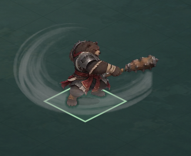
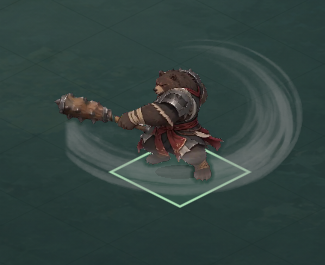

# 熊山君前向残影 v3：07 定向独立复验

2026-11-02 · D-20261102-002 · 冻结素材 e7d7b4d／运行 52456d5／06交接 83da3ac／00基线 60e82b5。

**结论：定向通过，关闭 BFV2-01「挥棍残影大面积缺失」。** 07在无缓存副本实际正常播放两前向，主弧已经呈现，渐隐侧随镜像换侧，指定邻帧未发现新增裁切或突兀的残影开关。此结论来自实际运行画面与独立检查，不只依据作者通过或散列。05完整源→候选→运行视觉复核及真人连续观感、设备听感仍待完成，不代表整体美术验收通过。[v2失败记录](QA_BEAR_FRONT_V2_20261102.md)原样保留；本报告是其定向修复结论。

## 本轮证据

| 范围 | 07结果 |
|---|---|
| 素材、时序继承、范围保护 | 775项，0失败 |
| 无缓存实际图形启动、轻量运行、正常播放 | 171项，0失败 |
| 截图归属、实际PTS、作者对应图、冻结保护 | 101项，0失败 |
| 总计 | 1047项，0失败；首次运行通过 |

[结构化结论](QA_BEAR_FRONT_V3_20261102.json)；证据目录 [qa07-bear-front-v3-20261102](qa07-bear-front-v3-20261102/) 含自建 `verify_scope.py`、`probe.gd`、`verify_render.py`、检查JSON、完整正常播放帧变更记录和GUI日志。作者1469/1380、3717项自测不是上述独立计数。

1. 入库与实际载入manifest SHA为 `53f2cd27b2678282ae8e8fa905b4ce8e46cded2623a7b9384e1c870c3b3e2237`。84张运行PNG逐字节等于v3候选，实际载入84张纹理RGBA也与运行PNG一致。相对v2恰好新38～51共14张变化，70张不变；所有v2完全不透明主体像素保持不变。
2. 原源10～93、PTS减5888、duration/decoded-source字段逐项沿用已验证v2；总46080 ticks/3秒、2.95～3.00末帧、0额外间隔。画布400×320、脚锚177,213、倍率.75、世界脚锚720,441及镜像通过。只对2.9499、2.95、2.9999、3.0做轻量边界，不重复上一轮全tick大矩阵或MOV冷复建。
3. WAV与v2完全一致，SHA `aaaf61ca9f75ebb4f8c9657108ac0a47245f0ef00efa38bd6a95066803b9caf9`。前后四次切向均产生新native playback、elapsed归零，对照同源native 0秒参考最大差0采样（容差2采样）；Dummy不代表设备音画延迟或实听。
4. 348个保护文件（背面帧／音频、棋盘、播放器、clips、场景和工程设置）与v2运行4421292一致。本轮运行全部在独立/tmp副本；启动前441文件，不含候选、`.godot`、`.import`。结束后441个冻结运行文件散列不变。

## 正常播放与画面判读

07使用Apple M1 OpenGL／Godot 4.7.2，专用1440×810窗口，Dummy且Master静音。两前向分别连续运行到6.1秒；循环内部不设置elapsed、不暂停、不跳帧指令。图像在真实frame_post_draw后截取，先存内存、运行后保存；26张角色裁片＋1张完整Viewport，均为引擎实际渲染，没有离线合成。20张与06同编号暂停采样逐像素一致，其中右前44裁片与本次完整Viewport严格对应。

两方向都在真实相邻呈现记录中观察到37→38、42→43、49→50→51→52和84→1，并保存37、38、42、43、44、45、48、49、50、51、52、84、1帧。右前两个循环共观察到82/84个不同帧，左前83/84；实际渲染最大时间步分别0.147671和0.012049秒（右前含首启），**不据此宣称每个8.33ms短帧都被显示或无抖动**。指定残影过渡均实际观察到；完整时序沿用上轮已通过验证。自动捕获及逐图审阅不等于真人连续观看。

- 右前43/44/45主弧清晰绕过角色两侧，48逐渐变弱；对照旧v2右前44几乎无弧，原BFV2-01有直接修复证据。
- 左前43/44/48与右前呈镜像关系，源右侧收边随镜像到屏幕另一侧；脚锚和棍体未出现运行额外裁切。画布内留有余量，未见白底矩形。
- 37无残影→38轻薄残影、42→43强弧、49→50→51逐渐消退→52无残影，所审样本未见新增突变。腿脚仍可见，残影与脚边灰带叠加为既有素材近似，不声称已恢复准确前后遮挡或关闭脚部/肩甲问题。
- 负责人已选用24源像素渐隐版。本轮接受此版本；源x=959画外缺失、灰145估计、贴身过渡及修棍近似保留，不据此要求重选或重绘。

## 失败、限制与交接

独立素材／运行／画面检查首次均无失败，GUI退出0，日志无脚本／资源／ObjectDB警告。过程有一次只读查询了不存在的旧辅助脚本路径（文件未复制），随后自建本轮证据校验脚本；一次未提升权限的进程列表读取受限，随后仅只读确认本轮自启进程已退出。这两项不计引擎失败，也未控制用户进程。

仅修改本报告／JSON、证据目录及07工作流；没有生产、美术、其他工作流或技能变更。无新增玩法确认。剩余事项为05正式视觉复核、真人持续体验/设备听感、OS鼠标键盘、Windows/移动端/PCK；本轮无新增生产必修。推荐00核收后安排05复核，不重复全量MOV复建或开启automation-3。

## Git交付

待本批明确清单提交后正常push一次，并只读核实远端；失败时保留本地成果，另记交付结果，不重推。
