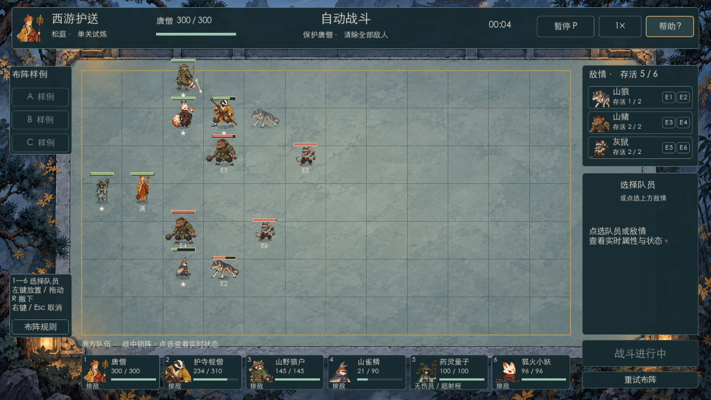

# D-20261009-001 同速、逐格规划与落格选敌独立验收

日期：2026-10-09。07在00正式释放后接管；登记`71184bd`，生产`b59227d`（包含同速`e20c995`、逐格调度`4893ee3`）。开始时Local干净、fetch确认Gitee 0/0。本批依据最新D001及06三批交接；没有沿用`64fc015`或作者成绩作为通过结论。

**结论：限定独立技术验收通过，无本批生产必修缺陷。** 七个原始布阵均自然到结果，固定阵容/敌阵的A/B/C具有可解释差异；不等于策略乐趣、正式平衡、全部拥堵或Windows通过。只新增07报告/证据与工作流，没有修改生产、数值、01/06/全局或运行媒体。

## 移动、选敌与交通安全

- 独立实际运行当前四专项：26逐格边界、60落格选敌边界、20横纵真实动作夹具及七局自然测试，完成数量与零失败尾行一并核对，无脚本错误。10移动演员均实际0.25秒半段、0.50秒落格；唐僧/药灵保持驻留。原HP、伤害、攻速、射程保留，半格/攻击活动不切换或打断，换目标不重置CD；同成本保旧及实际射程内保持由现行专项验证。
- 07自建10个补测全部完整运行、零失败。6例使用原血量、伤害和冷却、全部存活者真实AI，分别检验实际活动源格完成/取消/死亡及上下镜像；不是CD100或冻结对手的自然性证明。另4例由真实双方AI争同一格，普通同龄按ID、差1e-9模拟秒的等待年龄仍优先于ID，反转收集顺序后结果相同；输方保持等待并实际接战，执行入口拒绝对向占源/占目的。
- 活动源夹具零基：棍僧(6,0)、E1(3,0)、猎户(5,0)、狐火(2,0)、唐僧(0,6)。明确从开战后状态令猎户发出(5,0)→(5,1)的合法整段，其余继续真实AI；等待者不能提前进入源格。完成例0.500秒同tick醒来直走，1.500秒真实range1首攻；0.250秒取消例在0.258333秒醒来，因猎户仍占源而绕行，2.258333秒首攻；同刻死亡例0.258333秒进入真正已空的源格，1.258333秒首攻。取消/死亡是明确事件边界注入，不冒充原始自然布阵。暂停冻结年龄/活动，重试清依赖、序号、请求与落格标志。上下镜像结果一致。
- 七局正常战斗逐STEP独立核唯一双端占用、四邻/完整段、精确脚点插值、真实攻击距离、不半格折返/换敌、目标切换CD及驻留/重试。37FPS×1与60FPS×2＋1.31秒附近暂停的14次完整report、发段、等待和受击事件逐字段相同；两轮共19640 STEP、622个已完成0.50秒段，10移动身份均有真实移动覆盖。
- 07用独立Python时间展开模型核82个真实规划快照：每个演员/布阵首个规划加全部反向段，以“等待1 tick / 完整移动60 tick”枚举到当前全部合法攻位的最早可达时刻，分别从原演员状态重建真实源释放/目的硬占用。最低成本和全部最低成本首步集合均与运行规划器一致，不复用其route搜索代码；包括需要绕路、等成本和反向段快照。它只证明当前快照的完整搜索，不是预测敌人未来位置或全局最优保证。
- 另7次仅增加目标观察的自然运行仍与上述完整report相同；10移动演员共181次目标变化：70初选、90旧目标死亡/不可达等失效、21次旧目标仍合法时严格更短。忙活动中换敌和合法旧目标非严格更短替换均为0，未发现扫描/落格换敌重置CD。

基础/AI、原近战活动交接、统一近战78边界＋2活腾格、三远程真实追击/CD/伤害/狐火溅射，以及旧自由护送、格子护送、整局阵亡共8项必要回归均实际零失败。旧路线缓存执行/差异步速/远程始终锁旧敌已被本批替代，不用它们强保旧战果；通用安全断言没有删除。

## 绕行、回头与等待的实际结论

21.37文字初阵（一基唐2,4/棍4,4/猎2,3/雀2,5/药1,4/狐3,4）实际棍僧0.008333秒(4,4)→(4,3)，0.508333秒→(4,2)；1.008333秒因下一格竞争等待，1.258333秒转为已存在近战活动交接，1.508333秒E1实际靠近后驻留接战。没有继续追旧攻位往上折返，也没有永久等待。使用已提交同速基线作对照；不把旧异速视频里的旧节点写成同速基线仍复现，未重新打开视频。

当前七局共13组前后相反格段，全部伴随目标变化；其中棍僧/猎户/狐火共10组。B棍僧3.508→4.008秒虽相邻两步立刻反向，但E1旧目标已失效，切至实际成本2的E2；A棍僧0.008→6.208秒及21.37多次回头之间包含实际攻击，不能把“上次移动方向相反”直接当成连续空跑。当前七局未发现这三者维持同一目标、无局面变化却原地往返的实例；82快照与切敌成本另行支持此限定结论。

这不证明任意布阵无死锁或所有视觉上的回头都合理。统一调度只按真实请求年龄排序，不保证全局无饥饿；尚未承诺移动的角色仍是硬障碍，新的腾格/目标变化可能使上一格方向事后显得绕路。真正封堵不通过穿人或超时判胜解开。本批仅七局和明确反例，无需擅自引入让位、嘲讽或新算法。

## 同阵容、同敌阵的站位差异

下表“同速旧版”直接引用已提交的`board-stepwise-20261009-baseline.json`（作者在`dba3f4d`改程序前采集），并与逐格前版证据对照；本批没有声称独立重跑旧版。新版全部为本次独立运行，未调整HP/伤害/攻速保旧结果。

| 原布阵 | 同速旧版→新版秒数 | 新胜败 / 唐僧HP | 新友军阵亡 | 新友军伤害 / 有效治疗 |
| --- | --- | --- | --- | --- |
| A | 9.525→11.825 | 胜 / 300 | 狐火 | 606 / 189 |
| B | 11.067→10.100 | 败 / 0 | 唐僧 | 524 / 0 |
| C | 12.017→10.558 | 胜 / 300 | 山雀 | 606 / 168 |
| D006 | 12.875→12.025 | 胜 / 300 | 棍僧 | 606 / 64 |
| D007 | 11.875→12.367 | 胜 / 270 | 狐火 | 606 / 96 |
| 11.55 | 10.725→12.725 | 胜 / 300 | 狐火 | 606 / 34 |
| 21.37 | 11.533→12.233 | 胜 / 300 | 山雀 | 606 / 124 |

- **A集中支援**：猎户/狐火0.508秒先输出，棍僧1.008秒接战。E1/E3/E5首先压棍僧，E2/E4/E6首先压狐火；唐僧全局无受伤。药灵1.175秒开始有效支援，总治疗189，但狐火仍死亡；猎户输出211、狐火120。保护核心成立，不能据胜利忽略输出英雄损失。
- **B暴露与脱节**：唐僧0.508秒先打，E1/E2/E3在1.508秒首先锁定唐僧接战，1.675秒首个实际伤害；两灰鼠2.008秒也先攻唐僧。棍僧5.008秒才首次接战，输出44，药灵没有有效治疗。唐僧累计承受300实际伤害后失败。当前固定布阵确实使核心更早暴露，并非换了一组更强敌人或改数值。
- **C上下覆盖**：猎户/山雀首个STEP起攻，棍僧与狐火0.508秒起攻。上路E1/E3/E5首先打棍僧，下路E2/E6先压山雀；山雀累计受90伤害阵亡，唐僧仍无受伤。药灵0.675秒开始治疗、总168；猎户240、狐火208输出高于A，但少一个存活英雄，不能只按用时称最优阵。

因此三阵的接战时刻、承伤对象、治疗覆盖、输出分配和胜败并未完全被自动聚团抹平。证据只支持这三份固定样例有可解释差异，不支持“更多布阵必有深度”或“玩家一定愿意反复调阵”；下一步仍应由负责人体验是否能据结果主动调整站位。

## 正常窗口、资源包与证据

正常OpenGL窗口实际运行成功清选专项，以及21.37布阵从真实开始按钮→逐帧战斗/接战→暂停/帮助/Esc→继续→自然胜利→重试。均退出0/零失败，没有本轮指针超时；此前系统指针问题未因此永久关闭。仅保存一张约4.5秒实际画面，角色脚点、棋盘、状态栏与当前阵型可见；一帧审阅不等于全动画/真人观感验收。

07独立一次有效PCK导出、263项资源策略实际通过，包含Stepwise模块及`board-v4-step-target`、`melee-stepwise-20261009`、`ranged-step-target-20261009`；包内七局完整report与本次独立源码逐字段一致（数值容差1e-9），旧free/escort场景实际初始化通过。没有Windows EXE/ZIP或实机发布。完整包哈希、七局完整报告/动作/等待/受击/切敌、反向段上下文、10补测和82搜索结果见[紧凑JSON](QA_BOARD_STEPWISE_20261009.json)。

临时脚本/原始日志位于`/tmp/qa07-stepwise-20261009/`，未作为运行资产；JSON保留其哈希和必要结果。可复跑入口为README当前的`board_trial_stepwise_test.gd`、`board_trial_step_target_test.gd`、`board_trial_uniform_movement_test.gd`、`board_trial_stepwise_natural_test.gd`；额外独立测试按本文具体夹具与JSON当前格/活动记录复现。所有本轮测试均完整完成，无脚本/解析/加载错误；系统证书、用户日志和编辑器设置写权限告警仍保留，不称全日志无ERROR。

07本批测试进程已退出，未关闭负责人原有试玩或Spine，未使用Codex自身UI。提交推送后交还干净Local/Git/本批GUI给00汇总；无需生产返修，不启动新制作批次。负责人真人手感/策略乐趣、任意拥堵、正式平衡、其他DPI/全屏/音频和Windows仍未验。
