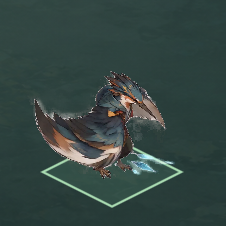
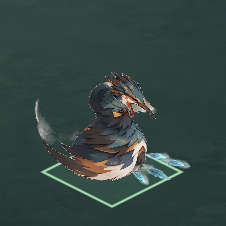

# C3翠鸟单向展示：07独立验收

2026-11-02 · D-20261101-002 · 00基线14c1bd6，冻结实现6349598／作者交付6f8ff00，素材a36cd56。

**单向必要技术验收通过，无新增程序必修。** 无缓存独立启动、98条来源映射、精确结束态、声音迟帧起播及重播/退出真正停声、正常播放29～34相邻过渡和引擎内输入均有独立证据。C3美术实际视觉、真人连续观感和设备听感未通过本轮代验；先交原C3美术，再由00安排既有授权镜像。本轮没有镜像或生产修改。

## 检查结果与证据

| 独立检查 | 最终结果 |
|---|---|
| 资源、自足目录与源PTS | 403项，0失败 |
| 真实引擎纹理／边界／声音／输入／正常播放 | 358项，0失败 |
| 原冻结映射／实际图／保护范围 | 138项，0失败 |
| 合计 | 899项，0失败；首轮夹具失败另列 |

[结构化结论](QA_C3_SINGLE_20261102.json)；[证据目录](qa07-c3-single-20261102/)保存独立脚本、初始和最终日志、全部断言明细、真实播放trace与10张PNG。06作者1032项等不算07独立计数。

- 101资源（98PNG＋manifest＋选定1秒WAV＋棋盘）与冻结候选原字节一致；manifest SHA `fd1ae8323bae9bbc24cef60a68fa715ed5228474bb7e9d11dfd4b13617f98b98`。98条与原冻结清单的index、SHA、PTS、duration、source_frozen_file逐项一致，包括0基30～32局部修复映射。原QA fail及06首失文件未动。
- 独立/tmp副本114文件，不含候选、来源视频、provenance、validation、`.godot`、`.import`或`.uid`；正式`launch.command`经指定Godot可无声Ready启动并自动退出0。实际测试中98张纹理RGBA与对应PNG完全一致；960²画布／475,760参考点／.21倍率／720,441世界点保持。结束后161个项目跟踪文件（含作者首失和最终证据）散列不变，熊展示／主游戏／冻结候选无差异。
- 全98时刻边界及97个正时长区间分别检查起点、中点、右端前；T=260250/90000≈2.891666667秒，T前仍96，T及以后Ended97。97源duration=0，仅作静态末态；额外推进到2.985或更久不延长时间、不循环。Ready和Inspection静态推进无声，重播归0、待发音事件清空。

## 声音与交互

只有一个播放器，生产max_polyphony=1，烘焙飞羽不新增节点或效果叠加。0.405秒为建议试接起点，四组独立native参考检查0.405／0.405001／0.605／1.404秒，按当前相位t−.405起播，误差最大1采样，小于2采样容差。起点前、恰1.405、1.6、T及之后不补旧声。该检查在短AudioServer锁内比较同WAV参考，不把异步预填游标当设备延迟。

正常播放、Ended后重播、声音活跃时重播，均使用`Input.parse_input_event`投递引擎内移动和鼠标按下/抬起，经过按钮命中与输入分发；未直接emit按钮信号，也未操作OS鼠标。四次投递都即时进入Playing、elapsed=0、旧播放器停止、事件清空。此为引擎输入检查，不等于真人OS点击；接口边界见[Godot Input文档](https://docs.godotengine.org/en/4.7/classes/class_input.html#class-input-method-parse-input-event)。

旧声停止独立采用真实混音观测：先确认旧游标从0.006235828推进至0.099115646，再通过实际重播或真正queue_free退出生产场景；跨2次mix时钟回绕后取游标，再跨3次回绕复核。两项旧游标都严格冻结于0.110725624；观察分别0.499313／0.516443秒，小于旧音剩余自然时长0.900884354秒。退出项唯一播放器确实释放。探针没有调用旧引用stop、mix、seek来制造停止，观察期也不锁混音；保留旧native.is_playing=true仅作诊断。

依据是[AudioServer混音时钟](https://docs.godotengine.org/en/4.7/classes/class_audioserver.html#class-audioserver-method-get-time-since-last-mix)及[4.7.2停止后淡出并移除播放节点的源码](https://github.com/godotengine/godot/blob/4.7.2-stable/servers/audio/audio_server.cpp#L367-L503)。该证据支持“旧声已退出实际混音”，不是仅凭清状态判定；全程Dummy＋Master静音，没有扬声器播放或录音。

## 正常播放实际画面

Apple M1／Godot 4.7.2／OpenGL真实1440×810专用窗口，循环内部不设置elapsed或Inspection、不手动驱动时间；frame_post_draw后采图，图像先留内存、结束后保存。共9张226×226真实画布裁片＋1张完整Viewport，9裁片均与06对应编号静帧逐像素相同，32裁片也与本次完整Viewport严格对应。不是离线合成。

| 0基编号 | 正常播放实际采样秒 |
|---|---|
| 29 | .500000 |
| 30 | .533333 |
| 31 | .583333 |
| 32 | .616667 |
| 33 | .666667 |
| 34 | .700000 |

连续trace确认29→30→31→32→33→34真实相邻呈现；已看到飞羽随源图出现、31至32形态改变，没发现运行新叠加飞羽、错误帧映射或画布外新增裁切。足尾附近灰软残留及飞羽突现的视觉接受度仍交C3美术，固定参考点不等于每帧脚掌天然贴地；.21及.405均未转为最终确认参数。

本次完整正常播放呈现90个不同索引，结束于精确T/97，并在继续等待后保持静态无声。90不等于资源缺8帧，也不宣称所有短帧上屏或真人流畅。自动trace和逐图审阅不代真人连续体验。

## 首失、未验与交接

07首轮夹具误用`res://showcase.tscn`，实际项目主场景为`res://main.tscn`，因此未加载生产场景。保留`probe-first.gd`／`gui-first.log`；仅向已确认本轮自启PID发送TERM，未操作用户原窗口。随后夹具改读项目的application/run/main_scene并加超时退出；生产未改，最终图形检查退出0，无解析／资源／ObjectDB警告。正式启动入口另验退出0。不能将最终通过写成首轮通过；06既有首次解析失败和旧native观测误用记录也全部原样保留。

本批仅新增本报告／JSON、证据目录及07工作流；无技能变更、无新玩法确认。尚未验：原C3美术源→候选→运行完整视觉、灰残留/飞羽/足点/首尾的接受度；真人连续体验；真实设备声音及音画同步；OS鼠标；Windows、移动端与发行包。镜像尚未实施，须单向必要技术与C3美术之后由00继续。

## Git与释放

待明确清单本地提交后，正常push一次并只读核实远端；失败保留本地并记录，不重推。专用GUI均已结束，收尾后主动向00报告并交回Local／Git／GUI；automation-3保持暂停。
