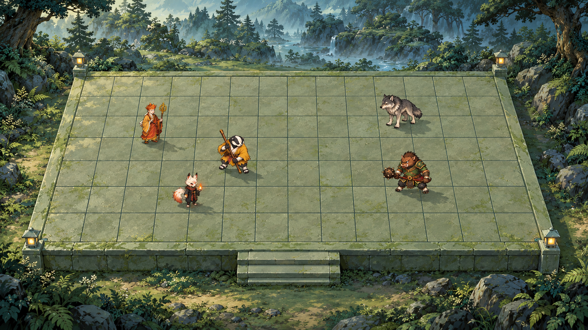

# 正面轻透视棋盘讨论候选

更新时间：2026-10-17
职责：05｜美术 / 角色 / UI（美术绘画）
范围依据：D-20261017-001。仅一张视觉讨论候选，未获采用确认。

## 本轮结果

保留首图 `board-perspective-candidate.png`。中心正对棋盘，约45°俯视意图、无左右侧转，前宽后窄；内格纵线与平台同步收束，行距向远处递减。前立面、中央台阶、森林石地与角色接地保持一致视觉方向。左侧唐僧、护寺棍僧、狐火小妖，右侧山狼、山猪，五个现有身份帮助观察尺度。主要呈现棋盘，不制作HUD。

实际图片为1672×941 PNG，接近16:9（并非精确16:9），原样保存，未裁切或代码改图。角度、收缩幅度、角色缩放均为生成视觉提案，未标定生产参数。

**目标为12列×7行，实际首图为14列×7行，网格要求未通过。** 主审与独立只读视觉复核均数得15条列边界、8条行边界；不含外围石框和前立面砖缝。一次仅针对列数的内置图像修订仍未成功，结果保存在 `history/grid-retry-not-adopted.png`，不作为第二方案；首图纹理较清楚，故保留首图供讨论。本批达到一次修订上限，不继续重绘。

## 自审与限制

- 主审与只读协作复核：居中正面、轻梯形及内网格透视方向成立；平台/台阶方向一致，角色未明显悬浮，远处单位可读，阵营左右关系正确。
- 格数不符合授权目标，不能称完整满足方案；可用于讨论空间观感，不能充当精确地图、部署区域或点击映射。
- AI生成的角色细节、脚点、阴影、材质和几何没有逐像素校准；没有角色重绘定案、动画/输入/实机或07独立技术验收。
- 若负责人认可空间方向，后续准确12×7投影、交互映射、素材分层与实际显示需另行安排，不从本图倒推出玩法或生产参数。
- 本轮未改Demo、代码、运行资产、导出配置或2D/3D路线。`.gdignore`隔离候选目录。未运行游戏或操作GUI，也未借用旧测试结论。

## 文件与来源

- `board-perspective-candidate.png`：唯一展示候选，首图原样复制。
- `history/grid-retry-not-adopted.png`：仅校正列数的一次失败修订，保留追溯。
- `PROMPTS.md`：两次完整提示词及输入角色说明。
- `source.json`：输入/输出路径、哈希、尺寸与选择结果。
- `.gdignore`：候选隔离标记。

由内置 imagegen 绘制。唯一现有媒体参考为 `../../production/directional_v1/review/formation.png`；未遍历历史图片、未采用外部素材或付费API路线。00释放Local并确认干净后才写入候选与05工作流；没有修改全局文档。

新确认事项：只有本轮候选制作范围，无视觉采用或玩法新确认。
待确认事项：负责人对正面轻透视观感的意见。
阻塞项：精确12×7格数未达标，阻止直接接入；不阻止作为明确标注的方向讨论图展示。
推荐下一步：先讨论空间方向，收到反馈后再决定是否安排准确几何与接入工作。

验证范围为图像视觉检查、文件尺寸/哈希、引用与Git变更范围；未进行不相关运行测试。
