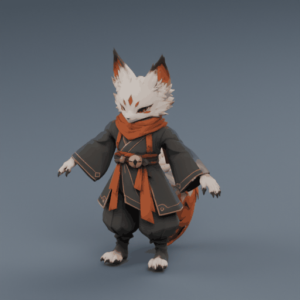

# 狐火混元模型：人形＋尾链绑定试验 v1

日期：2026-10-12。负责人明确要求“你试着绑定一下骨骼？”。本批只制作独立绑定候选，原始GLB、既有二维素材和游戏程序保持不变。本目录由`.gdignore`隔离。

## 打开与操作

在Blender中使用 **文件 → 打开**，选择[foxfire-rigged.blend](foxfire-rigged.blend)。这是可编辑工程，不再需要导入原始GLB。若现有场景有未保存工作，先保存自己的场景。

- 工程保存为材质预览、姿态模式，骨架开启在前显示。初始是放松手臂的检查姿势；原始T姿仍是骨架的休止姿态。
- 鼠标放在三维窗口，按空格播放或暂停6秒绑定测试。时间轴标记对应左右摆尾、左右肘腕、左右膝踝检查；这不是待机或走路成品。
- 手动试转：暂停，左键选择一根骨骼，按`R`转动，左键确认、`Esc`取消。选择`tail_01`可控制尾根，`tail_02`至`tail_05`控制后续尾段。姿态有测试关键帧，切帧会回到测试动作；保存个人试改请另存新文件。
- 骨架属性的“休止位置／姿态位置”可以切换查看原始T姿与绑定姿势。
- 预览相机、灯光、地面在独立集合中，只服务检查，不包含在导出的角色GLB里。

交给其他三维工具或引擎时使用[foxfire-rigged.glb](foxfire-rigged.glb)，其中包含蒙皮、骨架、贴图和同一段检查动画。跨机器先更新项目，再打开本目录文件；模型和贴图不依赖Downloads或外部图片路径。

## 本次做了什么

- 新建25根骨骼：1根非变形root，骨盆／脊柱／胸／颈／头5根，双侧锁骨／上臂／前臂／手8根，双侧大腿／小腿／脚6根，独立尾链5根。尾链从骨盆接出。
- 建立实际蒙皮权重，每个顶点最多4根骨骼影响并归一化；没有未加权顶点。使用关节坐标分区、临时合并重合点的拓扑标签和权重平滑，不把此过程称作Blender“自动热权重”或手工逐点精修。
- 尾根用实际连通关系与原贴图取样辅助判断，区分浅色尾毛与红围巾；独立内部小片随尾链，不删除原件已有小片或补洞。临时拓扑图只用于标签和权重，未焊接输出网格或改UV。
- 裆部中线增加骨盆权重，避免左右腿分摊把中央衣料拉开。独立检查确认原局部短边最大拉伸由8.17倍降至2.82倍（0.000831→0.002344，原始模型单位）。
- 6秒检查动作包含头、左右肩臂／腕、左右髋膝踝与五节尾链的实际变形；不是整张图片平移／旋转。主体保持原始约1.041单位高度。



GIF由实际Blender工程渲染，512²、48帧、6秒（8fps；工程动作24fps）；相机绕模型转动，同时播放检查动作。它是离线预览，不是Godot实机画面。AgX、检查灯光和地面仅用于预览；源贴图未调色。

## 验证与限制

原始[source.glb](../hunyuan_model_review_v1/source.glb)的SHA保持`0bef120b2d008b67d57df7bbe5317fec8da1e1a07c860533eb9eb838daf0a425`。最终新GLB SHA为`d50341a27fee716429b04d33264ca3a40ffa346f2f765ab7adbe44021bbb4f76`。

- 作者实际Blender5.2.2构建、保存工程、导出后重新导入成功：1骨架、25骨、5节尾链、有效动作与全顶点蒙皮；两侧肢体及尾巴网格发生实际变化，循环首尾相同。休止姿态最大顶点误差约8.56e-8。
- 独立二进制解析＋145采样CPU蒙皮复核：1 skin、25 joint、18条实际变化旋转通道，40,310导出顶点全加权、每点最多4影响，权重和最大误差1.79e-7。源网格40,292点，重导出因属性分裂增加18点；三角数50,789不变，三角角点位置误差7.06e-8、UV一致，法线最大向量差约0.013。不能称绑定版与原件逐字节相同。
- 三张内嵌4K PNG与原件逐字节一致，材质及采样器保持。导出器有“多个图像节点用于纹理，使用首个采样器”的警告；独立结果未见本文件纹理／采样器变化，不把警告隐瞒为全程零警告。
- 主审查看放松、抬臂、背面摆尾、侧面屈膝及转台抽帧；独立只审最终3张静态图，未见明显肢体脱离、尾根开裂或大块纹理错位。腿部有遮挡，静帧不证明所有关节或连续动作质量通过。
- 仍有腋下／袖根附近极短边在放松姿势拉伸约4.88倍（0.001292→0.006309），后续检查动作未放大这一最大值；受检静帧未见明显破裂。权重属于第一版候选，宽袖、袍摆、尾根大幅姿势及全身穿插需要进一步检查，不宣称完全无穿模。
- 这是逐级旋转骨骼的FK试验，没有IK控制器、独立手指／表情骨骼、布料或毛发模拟；还没有正式待机、走路、攻击、受击、死亡动画。未接入Godot、未测试游戏帧率或多单位同屏。模型商用许可未独立核实，保持项目非商业试验边界。

## 文件与复现

- [rig-report.json](rig-report.json)：骨骼位置、权重、作者姿势数值检查。
- [roundtrip-report.json](roundtrip-report.json)：实际GLB重导入和变形验证。
- [independent-review.json](independent-review.json)：最终文件的独立复核摘要和限定视觉结论。
- [preview-report.json](preview-report.json)：GIF帧数、时长与哈希。
- 四张实际渲染：[放松正面](relaxed_front.png)、[摆尾背面](tail_test_back.png)、[抬臂正面](arm_test_front.png)、[屈膝侧面](leg_test_side.png)。

在安装Blender及Python/Pillow的机器，本目录中执行（`blender`替换为本机程序路径）：

```sh
blender --background --factory-startup --disable-autoexec --python-exit-code 1 --python build_rig.py -- --render
blender --background --factory-startup --disable-autoexec --python-exit-code 1 --python check_and_preview.py -- --render
python3 encode_preview.py
```

这些命令只重建本候选，原始模型不写回。`preview_frames/`是可重建的中间帧，未纳入Git；正式GIF、工程、GLB、报告和制作脚本为本批待同步交付范围。

## 远端同步授权

本地制作和复核已完成。此前自动安全审批在进程创建前拒绝批量上传新生成的Blender工程、绑骨GLB和GIF，要求对派生文件单独确认；当时未暂存、提交或推送，未换入口绕过。2026-10-13负责人针对具体文件和项目Gitee的询问明确答复「允许，将绑定和奔跑成果一起推送到项目 Gitee」，本授权阻塞解除。本候选与新`../hunyuan_run_v1/`一并完成验证后提交推送；实际远端提交以Git记录为准，原始模型77b589c不变。

建议下一步先由负责人打开工程检查绑定观感，确认后再制作正式待机／走路；本次绑定试验不等于全员三维迁移或运行接入确认。
