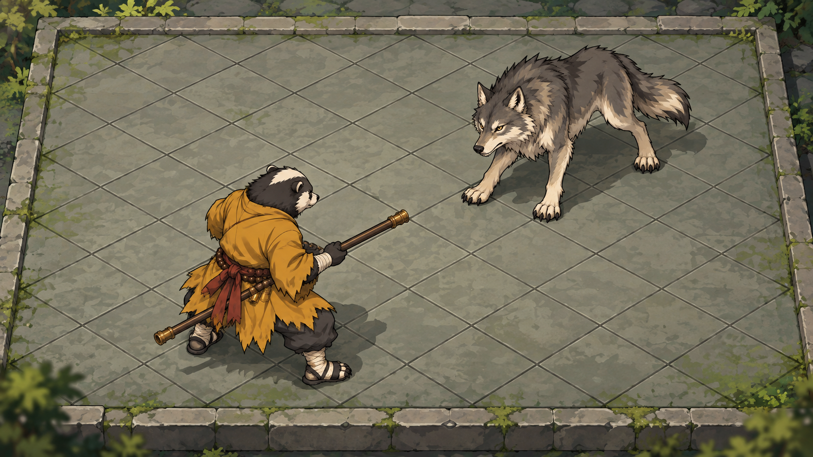

# 长方形场地内菱形格：棍僧／山狼静态样板

日期：2026-10-18
职责：05｜美术 / 角色 / UI（续2）
授权：D-20261018-001。单张视觉提案，负责人尚未确认，未接入游戏。

## 交付

内置imagegen首轮生成，保留原样1672×941 PNG（接近16:9）；未用额外修订。横向近长方形石质场地，内部两组交叉斜线形成菱形格，外缘允许截断半格。左下棍僧以斜背朝向右上山狼，山狼以斜前朝向棍僧；仅两角色，无UI、动作序列或运行地图。

两张直接参考各查看一次，只保身份服饰体型，重新绘制适配共同斜俯视相机的站姿，没有把原图贴到场景、翻转或整体压扁。棍僧保留獾类黑白脸、赭黄僧衣、长棍、佛珠与红褐腰带；普通山狼保灰褐毛、浅胸腹、尖耳长尾及四足身份。参考路径和哈希详见[source.json](source.json)，完整提示词见[PROMPT.md](PROMPT.md)。

## 静态检查与限制

- **作者自审**：外框长轴近水平，内部是两组斜线菱形格，非把整场地转成尖角菱形；棍僧头顶、肩背和山狼头顶、背部上表面可辨。角色沿格斜向相对，脚点与阴影接地，未见旧近侧视图直接粘贴感。
- **只读视觉复核**：协作复核建议保留首轮，无明确必须修订项；仅检查本张静态图，不代替负责人确认、07技术验收或动画验收。
- 外框两侧仍有轻微透视收束，属于近长方形，不是数学上的正交矩形；网格间距也未做精确几何标定。相机约45°是制作意图，不能从AI图当作实测角度。
- 山狼清楚可辨三只爪，远后腿落在躯干遮挡区；单图不能确认第四脚完整形体，也不足以断言缺肢。后续若需要动作/转向资产，须单独核对四肢结构，本轮不扩制作。
- 轮廓、握棍与服饰细节属于本次重新绘制的候选，不自动替换现有角色基准；透明拆层、精确脚点、连续动画均未制作。
- 不规定12×7或其他准确格数，不改变棋盘规则、寻路、点击区域或2D/3D路线。未改.gd/.tscn/production/导出配置，未运行游戏或操作GUI。

## 保存与验证

- `rect-iso-monk-wolf-candidate.png`：唯一交付主图，内置工具输出原样复制。
- `PROMPT.md`：本轮完整提示词。
- `source.json`：输入参考、输出来源、尺寸哈希与复核状态。
- `.gdignore`：独立候选隔离。

已检查输出尺寸、PNG签名、源与副本哈希、两参考哈希和文档链接。原图及运行资产保持。
新确认事项：仅本轮单张样板制作授权；没有新造型、玩法或动画采用确认。
待确认事项：负责人对场地外形、菱形格与双角色俯角的观感。
阻塞项：无本静态提案展示阻塞；上述四足遮挡与几何限制保留。
推荐下一步：00展示实际图并收集反馈，不自动生成动作或安排运行接入。
